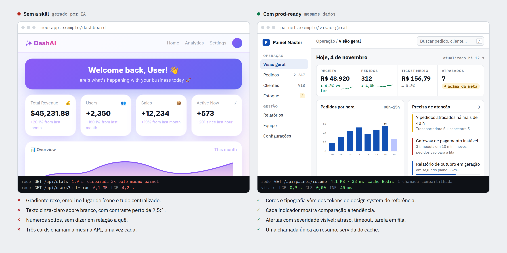
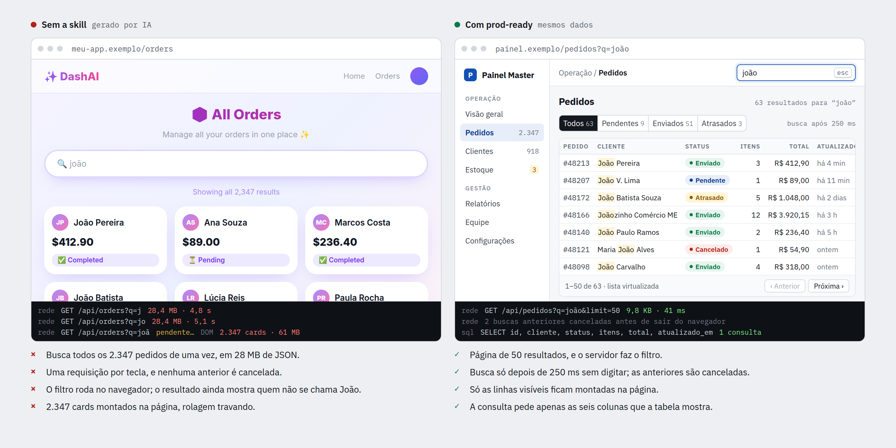
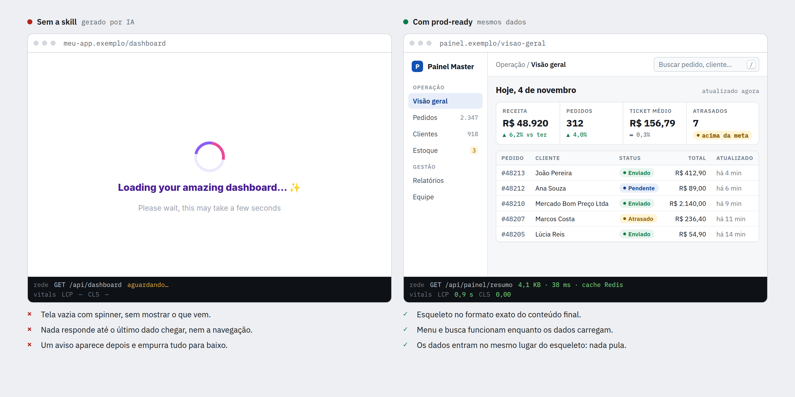
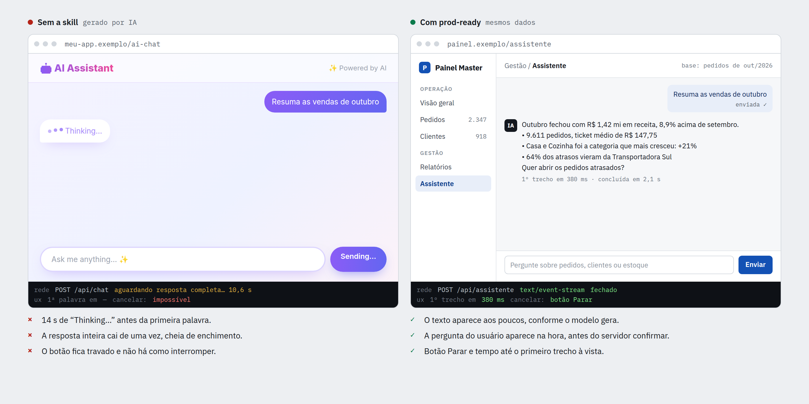

# ⚡ Prod-Ready — Claude Code Skill

[](LICENSE)
[](https://claude.ai/code)
[](#-os-25-mandamentos-de-performance--arquitetura)
[](#-o-design-system-anti-ai-slop)

> **A skill definitiva para o Claude Code que impede inteligências artificiais de criarem código lento, desotimizado e interfaces genéricas ("AI-slop") desde o primeiro prompt.**

Disponível para a comunidade de desenvolvedores para transformar o Claude em um Arquiteto Sênior de Software e Designer de Interfaces de nível enterprise.

---

## 👀 Antes e depois

O mesmo painel de pedidos feito duas vezes. À esquerda, o que a IA gera sem orientação. À direita, o resultado com a skill `prod-ready`. A faixa escura embaixo de cada tela imita o painel de rede do navegador. Todos os números são dados de exemplo.

### 1. Painel
A primeira tela depois do login: tema genérico e chamadas repetidas, contra tokens do design system e uma chamada servida do cache.



### 2. Lista de pedidos
Buscando os pedidos do João: uma requisição de 28 MB por tecla, contra debounce, paginação e só as colunas necessárias.



### 3. Carregamento
Enquanto os dados chegam: spinner em tela vazia, contra um esqueleto no formato da página.



### 4. Assistente de IA
Pedindo um resumo: 14 s de “Thinking…”, contra resposta transmitida aos poucos, com botão Parar.



---

## 🛑 O Problema: Código Padrão de IA vs. Vida Real

Quando você pede para uma IA construir um aplicativo ou backend, ela quase sempre recorre a padrões ingênuos:

- ❌ **Interfaces "AI-Slop"**: Cards roxos flutuantes com gradientes genéricos, textos cinza sem contraste, falta de hierarquia tipográfica e ausência de navegação real para desktop/mobile.
- ❌ **Lentidão e Spinners Infinitos**: Spinners giratórios de tela inteira que bloqueiam o usuário e causam enormes saltos de layout (*Cumulative Layout Shift*).
- ❌ **Gargalos de Backend**: Consultas `SELECT *` sem paginação que tentam retornar milhares de linhas em um único JSON de 30MB.
- ❌ **O Pesadelo do N+1**: Loops no backend que disparam dezenas de queries desnecessárias ao banco de dados.
- ❌ **Travamento em Tarefas Pesadas**: Geração de relatórios, envios de e-mail e chamadas a APIs externas executadas no meio do ciclo HTTP síncrono do usuário.

A skill **`prod-ready`** foi criada para impor rigor de engenharia de software e design autêntico desde o início do projeto.

---

## ✨ O que a Skill `prod-ready` Entrega

1. **25 Mandamentos de Performance & Arquitetura**: Regras inegociáveis que cobrem desde Redis, filas assíncronas (BullMQ/Celery) e paginação estrita até deduplicação de requisições, compressão Brotli e conexão em pool.
2. **Design System Humano de +3.500 Linhas (`references/design-system.html`)**: Uma referência completa e sanitizada de arquitetura de interface humana — sem qualquer marca ou referência governamental/corporativa — com tokens CSS `:root`, escala tipográfica hierárquica, navegação responsiva com drawer mobile, atalho global de busca (`/`), abas acessíveis (WAI-ARIA), modais com focus trap e diagramas vetoriais SVG otimizados.
3. **Guia Prático de Implementação (`references/performance-rules.md`)**: Exemplos em TypeScript e HTML contrastando o anti-padrão comum da IA com a solução de produção.

---

## 🚀 Como Instalar

### Opção 1: Instalação Global no Claude Code (Recomendada)
Para ter a skill ativa em todos os seus projetos no Claude Code:

```bash
git clone https://github.com/flfontescreator/prod-ready.git ~/.claude/skills/prod-ready
```

### Opção 2: Instalação em um Projeto Específico
Se você deseja incluir a skill diretamente no repositório do seu projeto:

```bash
# Na raiz do seu projeto
mkdir -p .claude/skills
git clone https://github.com/flfontescreator/prod-ready.git .claude/skills/prod-ready
```

Pronto! O Claude Code carregará a skill automaticamente.

---

## 💡 Como Usar

Você pode acionar a skill explicitamente ou usá-la como estilo de desenvolvimento:

```text
> Crie um painel de administração prod-ready para gestão de pedidos
```

```text
> Implemente a API de autenticação e perfil de usuários seguindo as regras prod-ready
```

```text
> Refatore este componente de listagem para eliminar layout shifts e aplicar skeletons e debounce
```

O Claude automaticamente ativará os 25 parâmetros de performance e usará os tokens e componentes do design system de referência.

---

## ⚡ Os 25 Mandamentos de Performance & Arquitetura

| # | Mandamento | Descrição / Implementação de Produção |
|---|---|---|
| **01** | **Zero-Lag Architecture** | Métricas Core Web Vitals rigorosas (LCP < 1.2s, INP < 50ms, CLS 0, TTFB < 150ms). |
| **02** | **Skeleton Screens** | Esqueletos visuais animados espelhando o formato exato do conteúdo. Zero spinners de tela cheia. |
| **03** | **Imagens em WebP/AVIF** | Tag `<picture>` com fallback, `srcset` responsivo e dimensões explícitas `width`/`height`. A imagem principal (LCP) nunca recebe `loading="lazy"`, e sim `fetchpriority="high"`. |
| **04** | **Deduplicação de Requisições** | Cache em memória de Promises em voo para leituras (GET) idênticas disparadas juntas. Escritas nunca são deduplicadas. |
| **05** | **Debounce com Cancelamento** | Debounce de 250-300ms em buscas e autocompletes, cancelando chamadas anteriores via `AbortController`, verificando `res.ok` e abortando no cleanup do `useEffect`. |
| **06** | **Paginação Obrigatória** | Cursor-based ou limit/offset com limite rígido (máx. 50-100 itens) em todas as rotas de coleção. |
| **07** | **CDN Global na Borda** | Todos os assets estáticos servidos via CDN (Cloudflare/CloudFront) com HTTP/3 e TLS 1.3. |
| **08** | **Filas Assíncronas (>200ms)** | Tarefas demoradas movidas para filas (BullMQ, Celery, SQS), retornando `202 Accepted` imediato. |
| **09** | **Eliminação de Consultas N+1** | Eager loading obrigatório (`include`, `JOIN`, subqueries agrupadas ou DataLoaders no GraphQL). |
| **10** | **Compressão Brotli / Gzip** | Compressão Brotli prioritária com fallback para Gzip no proxy reverso/edge. |
| **11** | **Cache com Redis** | Padrão *Cache-Aside* para dados de alta leitura com TTLs explícitos e invalidação orientada a eventos. A chave de cache inclui sempre o escopo de acesso (tenant e, quando o dado depende de permissão, o usuário). Ex.: `t:{tenantId}:orders:list:{hash(filtros)}`. Invalidação sempre depois do commit. |
| **12** | **Zero Dependências Não Utilizadas** | Auditoria de bundles, tree-shaking rigoroso e uso de APIs Web nativas (`fetch`, `Intl`, `URL`). |
| **13** | **Timeouts Rígidos & Circuit Breaker** | Limite máximo de 3 a 5s para APIs externas com circuito de proteção contra falhas em cascata. |
| **14** | **Streaming Token por Token para IA** | Respostas de LLMs transmitidas via Server-Sent Events (SSE), entregando o primeiro token em <500ms. |
| **15** | **Atualização Otimista (Optimistic UI)** | Ações de alta frequência refletem instantaneamente na tela com rollback e toast em caso de erro. |
| **16** | **Lazy Loading Sob Demanda** | Imagens abaixo da dobra com `loading="lazy"` e `content-visibility: auto` para seções extensas. Nunca lazy na imagem principal (LCP). |
| **17** | **Divisão de Código por Rota** | Carregamento assíncrono via `React.lazy` / `import()` dinâmico apenas do código da rota acessada. |
| **18** | **Virtualização de Listas e Tabelas** | Virtualização de DOM (TanStack Virtual) em coleções com mais de 50 itens montados em tela. |
| **19** | **Projeção Estrita de Colunas** | Proibido `SELECT *`. Especificar explicitamente apenas os campos consumidos pelo frontend. |
| **20** | **Connection Pooling** | Pool de conexões ativo (PgBouncer/Prisma/SQLAlchemy) reutilizando conexões abertas com o banco. |
| **21** | **Prevenção de Re-renderizações** | Isolamento de estados de alta frequência e memoização estratégica (`useMemo`, `useCallback`). |
| **22** | **Headers de Cache Imutáveis** | Assets com hash servidos com `Cache-Control: public, max-age=31536000, immutable`. HTML e APIs autenticadas com `private, no-store`. |
| **23** | **Arquitetura 100% Stateless** | Aplicações sem estado em memória local, prontas para escalonamento horizontal com réplicas. |
| **24** | **Fontes Web Leves Auto-Hospedadas** | Arquivos WOFF2 subsettados, limitados a 2-3 pesos (<30KB) com `font-display: swap` e fallback de sistema. |
| **25** | **Monitoramento RUM & Testes Lentos** | Coleta de dados reais de usuários (RUM) e testes obrigatórios sob rede emulada Fast 3G e CPU 4x Throttling. |

---

## 🎨 O Design System Anti-AI-Slop

O arquivo `references/design-system.html` serve como a bússola visual da skill:
- **Design Tokens Semânticos**: Cores divididas entre superfície, texto, ações principais e feedbacks de estado (sucesso, alerta, perigo e neutros).
- **Tipografia Escalar**: Proporções calibradas entre títulos principais (`Display`, `H1`), seções (`H2`, `H3`), textos auxiliares (`Lead`, `Body`) e legendas (`Caption`).
- **Navegação Real e Ergonômica**: Sidebar categorizada, drawer móvel acessível por toque, barra de pesquisa com atalho de teclado (`/`) e breadcrumbs contextuais.
- **Micro-interações Acessíveis**: Controle de abas com suporte total a leitores de tela e navegação por teclado (`Tab`, setas, `Enter`).

---

## 📊 Comparativo: Aplicação Típica de IA vs. Prod-Ready

| Métrica / Critério | Código Gerado por IA Comum | Aplicação com `prod-ready` |
|---|---|---|
| **Lighthouse Performance Score** | 35 – 55 | **98 – 100** |
| **Largest Contentful Paint (LCP)** | 3.8s – 5.2s | **0.8s – 1.1s** |
| **Cumulative Layout Shift (CLS)** | 0.28 (ruim) | **0.00 (perfeito)** |
| **Interaction to Next Paint (INP)** | 280ms (lento) | **< 45ms (instantâneo)** |
| **Consumo de I/O de Banco de Dados** | Alto (N+1 queries, `SELECT *`) | **Mínimo (Eager loading, projeção de colunas)** |
| **Design Visual** | Purple gradient AI slop | **Enterprise Design System limpo e acessível** |

---

## 📁 Estrutura do Repositório

```text
prod-ready/
├── SKILL.md                          # Definição e regras oficiais da skill para o Claude Code
├── README.md                         # Documentação pública e guia de instalação
├── LICENSE                           # Licença de código aberto MIT
├── assets/antes-depois/              # Imagens de antes e depois usadas neste README
└── references/
    ├── design-system.html            # Referência com +3.500 linhas de Design System sanitizado
    └── performance-rules.md          # Especificação técnica detalhada dos 25 mandamentos
```

---

## 🤝 Contribuições

Contribuições da comunidade são muito bem-vindas! Se você tiver melhorias nos parâmetros de arquitetura, novos componentes no design system ou casos de uso adicionais:
1. Abra uma *Issue* para discutir a melhoria.
2. Envie um *Pull Request* detalhando a alteração.

---

## 📄 Licença

Este projeto é distribuído sob a licença **MIT**. Veja o arquivo [LICENSE](LICENSE) para mais detalhes.
